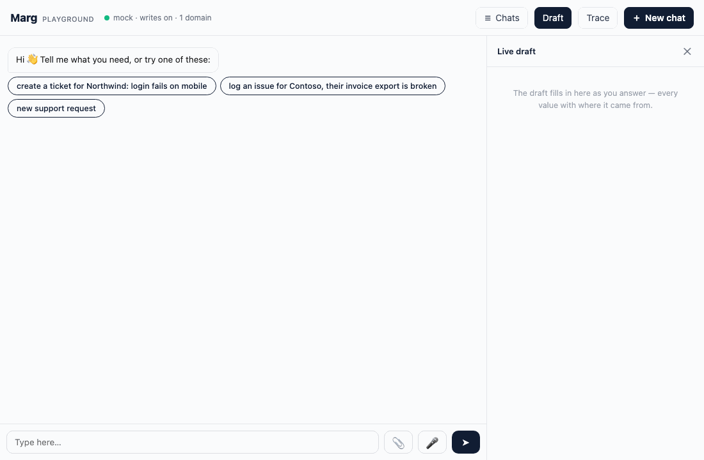

# Marg

**The Agent Development Kit for conversational agents that finish a job.**

<p align="center">
  
</p>

Marg (मार्ग, "the path") is a TypeScript framework for agents that take a person from a first
sentence to a completed action against a real backend: a ticket raised, a listing published, a
booking made, an application submitted, an order placed. It ships the runtime, the client, the
decision engine, the eval harness and the production spine. It was extracted from an agent that
is live with real users, not designed on a whiteboard: every mechanism in it is here because its
absence cost something.

[](https://github.com/marg-adk/marg/actions/workflows/ci.yml) [](https://github.com/marg-adk/marg/actions/workflows/codeql.yml) [](https://scorecard.dev/viewer/?uri=github.com/marg-adk/marg) [](LICENSE) [](.nvmrc)

<!-- npm badge once published: [](https://www.npmjs.com/package/@marg/core) -->

## Is Marg for you?

**Use Marg when**

- Your agent must **complete a transaction**, not only answer: collect what the backend needs,
  validate it, show it, get an explicit yes, write exactly once.
- The result is **published under a real user's name**, so a guessed value or a silent write is
  a real cost, not a bad demo.
- You will have **several specialist agents behind one entry point** (a "super agent") and you
  want routing you can measure instead of a prompt that hopes.
- You need to **prove behaviour before and after every change** without burning model credits:
  scripted conversations, a deterministic mock model, CI with no key and no network.
- You are going to **run it yourself**: identity, limits, caps, cost tracking, dashboards,
  graceful deploys, and a client people use on a phone.

**Look elsewhere when**

- You want a general library for arbitrary agent graphs. Marg is opinionated about one job
  shape: *collect → validate → confirm → write*.
- Your bot only answers (RAG, FAQ, search) and never writes anything.
- You want a hosted platform. Marg is code you run.
- Your stack must be Python end to end. Marg is Node ≥ 22 / TypeScript; your backend and tools
  can be anything that can sit behind an MCP tool server.

## Two minutes to a running agent

```bash
npx create-marg-app my-agent && cd my-agent
npm install
npm run gateway             # http://localhost:8787 — .env holds LLM_CHAIN=mock: a scripted offline model, no key
```

Or work in the repository itself (the same gate CI runs, every check, the docs):

```bash
git clone https://github.com/marg-adk/marg.git && cd marg
npm install
cp .env.example .env        # LLM_CHAIN=mock — a scripted offline model, no key needed
npm run gateway             # http://localhost:8787
```

Open the playground and type **"ticket for Northwind: login fails on mobile"**. You will see a
customer picker, category chips, a details card the runtime draws and reads itself, priority
chips, a summary card with *Change something*, and the create. Switch to a real model by editing
one line in `.env` (`LLM_CHAIN=anthropic`, `LLM_CHAIN=openai,anthropic`, `LLM_CHAIN=ollama`);
nothing else changes.

Then run the gate, the same one CI runs:

```bash
npm run gateway:evals &     # a second gateway on :8788 with writes OFF
npm run evals               # the example's scenarios, deterministic checks, exit code = the gate
npm test                    # unit tests, including the widget driven under a fake DOM
npm run check:otel          # spans, metrics and trace-carrying log lines, against in-memory exporters
npm run check:scaffold      # the templates still produce a domain that compiles and passes its own suite
npm run check:e2e           # the real write path with writes ON, end to end
npm run check:pack          # every package builds and packs clean for npm
npm run check:create        # create-marg-app from local tarballs: install, boot, the example suite
```

## What you get

**A runtime that owns the moments that must be right.** The model owns the conversation. The
runtime owns forms, pickers, option chips, the confirmation summary and the create gate: it
draws them, reads the reply in code by its *whole* content, carries what settled into every tool
call, and tells the model one fact. A model that skips a question, invents a value, or treats
"yes but change the title" as a yes cannot do so here, with any model in your chain.

**Typed decisions instead of prose.** Routing between domains, reading a confirmation, checking
a condition before a write: these are `choice` / `noul` / `score` questions answered with
calibrated probabilities, not sentences you parse. Verdict answers them with rules first, a
decision model second, and an LLM with logprobs last. The decision model is
[Laya](https://github.com/NandhaKishorM/laya) (Apache-2.0, `ollama pull laya`), spoken over the
System One protocol, so you get an open-source alternative to a hosted decision-model API, with
abstention and calibration maths included.

**One entry point, many domains.** A domain is a folder: a manifest, markdown skills, an MCP
tool server for your backend, a schema registry, runtime-owned steps, a mock model for offline
runs, an eval suite. Drop it in and the gateway discovers it at boot. The super agent routes one
domain per turn, stays sticky, and costs nothing until your second domain exists.

**A client people can use on a phone.** One `<script>` tag, Shadow DOM, zero dependencies:
streaming replies, chips, multi-select, lists, cards with inline edit sections, forms with
readable echoes, tables, progress, media tiles, resume after a reload, nudges, voice notes,
uploads before the record exists. Or speak the documented client protocol from your own app.

**The production spine.** Identity verified against your service and failing closed; owner
checks on every session; an agent-token exchange for embedding in apps; rate limits with refunds
for runtime-answered turns; usage caps shown to users as percentages; pass-through metering that
bills only what vendors bill you; OpenTelemetry in the GenAI conventions with dashboards and
alerts for OpenObserve; structured logs that carry the trace id; graceful shutdown; a non-root
image, Compose profiles and TLS at the edge.

**Evals as the ratchet.** Scenarios replay conversations against a writes-off gateway with
deterministic checks: which block was drawn, which tool was or was not called, what the draft
holds, whether a reload redraws the open question. Sharding, reruns, a flake ledger and a
classified gate report. The bundled mock model makes the whole platform run in CI with no key.

## How it works

```
user ──▶ widget / your app ──▶ gateway (sessions · limits · caps · identity · media · voice)
                                  │   super agent: ONE domain per turn (a typed decision)
                                  ▼
                           domain agent = skills (markdown) + MCP tools (your backend)
                                  │      + runtime-owned steps (forms · pickers · summary · create gate)
                                  ▼
                 model chain (any provider, failover, breaker)  ·  Verdict (rules → Laya → logprobs)
```

Five rules hold the design together:

1. **Within a domain, compose skills; across domains, delegate through the super agent.**
2. **The model owns the conversation; the runtime owns the moments that must be right.**
3. **Typed decisions are not prose.** Calibrated probabilities, abstention, a cascade.
4. **The write gate exists three times** (skill rule, tool schema, runtime guard) and never
   weakens. Probe the real backend before trusting its documentation; most validate nothing.
5. **Evals are the ratchet, and a feature is not done until it is visible on a panel.**

[docs/PATTERN.md](docs/PATTERN.md) explains each rule and the failure it answers;
[docs/LESSONS.md](docs/LESSONS.md) is the field notebook behind them.
[The model must never read "yes"](docs/posts/the-model-must-never-read-yes.md) is the launch
post: the one number that shaped the design, and a step in twenty lines.

## The path to your own domain

```bash
npm run new-domain -- bookings --entity booking      # scaffolds domains/bookings from templates/
```

Then build in this order, because each step feeds the next
([docs/PLAYBOOK.md](docs/PLAYBOOK.md), [docs/guides/new-domain.md](docs/guides/new-domain.md)):

1. **Tools.** Reads plus the triad `validate_booking_slots` → `preview_booking` →
   `create_booking` in `mcp/server.ts`, against your backend. Validate is write-free and runs
   after every slot change; create refuses without `confirmed: true`.
2. **Probe.** Create one known-good record on your dev backend, then strip one field at a time.
   What the server really enforces goes into the schema registry; most documentation is wrong.
3. **Schema registry.** Slots, sources, mandatory sets, ask sets, probe findings. One file.
4. **Skill.** The orchestrator in markdown: entry, the record cascade, one question per turn,
   what the runtime owns, the never-rules. Variants are small deltas, never copies.
5. **Steps.** The moments a wrong answer would cost, as runtime-owned steps: three helpers
   (`chipsStep`, `multiStep`, `formStep`) cover most; implement the interface for the rest.
6. **Evals.** The coverage checklist: the happy path per variant, the confirm gate, the picker,
   a mid-flow correction, words typed beside an open ask, a partial form, the review, an injection
   probe, resume.

Walk the journey in the playground as you go. The example domain is the reference for every
part; copy from it freely.

## Use all of it, or a part

- **Verdict alone.** `npm run verdict` is a CLI, `npm run verdict:mcp` an MCP server, and
  `packages/verdict` exposes a System One-compatible HTTP server, so any agent stack can ask
  typed questions of rules, Laya or an LLM through one interface ([docs/DECISIONS.md](docs/DECISIONS.md)).
- **The readers alone.** `readYesNo`, `readChoice`, `readAmount`, the form wire format and the
  review picker's reader are pure functions in `@marg/core`, usable in any Node service
  ([docs/guides/readers.md](docs/guides/readers.md)).
- **The eval runner alone.** It drives any gateway that speaks the client protocol.
- **The widget alone.** Implement [docs/CLIENT-PROTOCOL.md](docs/CLIENT-PROTOCOL.md) behind it.

On npm: `@marg/core`, `@marg/types`, `@marg/verdict`, `@marg/evals`, `@marg/metering`,
`@marg/gateway` (with the `marg-gateway` command), `@marg/widget`, and `create-marg-app`.
The repository builds them with `npm run build`; development runs the TypeScript sources
directly through `tsx`, no build needed.

## Going to production

- [docs/PRODUCTION-CHECKLIST.md](docs/PRODUCTION-CHECKLIST.md): the gate before the first real
  user, in seven sections, from identity to deploy hygiene.
- [deploy/DEPLOY.md](deploy/DEPLOY.md): one image, Compose profiles for stores, observability,
  decisions (Ollama serving `laya`) and the TLS edge; how to operate, scale and roll.
- [docs/OBSERVABILITY.md](docs/OBSERVABILITY.md): the trace tree of a turn, the metrics, the
  standing rule "done = visible on a panel", `npm run o2:bootstrap` for dashboards and alerts.
- [docs/SECURITY.md](docs/SECURITY.md) and [docs/SDK-AUTH.md](docs/SDK-AUTH.md): identity,
  sessions, writes, the link allowlist, the agent-token exchange for apps.
- [docs/METERING.md](docs/METERING.md): plan tokens, caps as percentages, pass-through billing.

## Why not something else?

Marg is not a replacement for a general agent framework; it is the layer you would otherwise
write on top of one when the agent has to finish a job for real users.

| | Orchestration libraries (graphs, handoffs) | Low-code builders | Marg |
|---|---|---|---|
| Who reads "yes" | the model | the model | the runtime, by the whole message |
| Forms, pickers, confirmation | your UI code, if any | the builder's | drawn and read by the runtime, carried into tool calls |
| Many domains, one entry point | you wire it | one bot per flow | drop-in domains, typed routing, sticky |
| Decisions | prompt and parse | prompt and parse | rules → decision model → logprobs, calibrated |
| Regression gate | your harness | manual | scenario runner, mock model, CI with no key |
| Identity, limits, caps, cost, telemetry | bring your own | platform's | included, model-agnostic |

## Measured in the field

These are the numbers that justified the design, from the agent Marg was extracted from.

| Observation | Result |
|---|---|
| Questions a model-led prompt skipped, despite the rule | 25 to 50 percent of turns |
| List items a model attested that the user never said | 1 chat in 64 |
| Typed replies a leading-word reader mis-read as a bare yes or no, blind corpus of 521 | 235 |
| The same corpus, read by the whole content | 0 |
| `ui` blocks malformed around the fence in production traffic | about 1 in 40, all parsed |

## Layout

| Path | What |
|---|---|
| `packages/core` | The runtime: skills, model chain, MCP tools, sessions, stores, steps, readers, guards, telemetry |
| `packages/verdict` | Typed decisions: rules, System One (Laya), LLM logprobs, cascade, calibration, CLI, MCP, HTTP |
| `packages/gateway` | HTTP + SSE: sessions, turns, voice, media, nudges, limits, caps, security, health, metrics |
| `packages/evals` | The scenario runner and check combinators |
| `packages/widget` | The embeddable client and its test harness |
| `packages/metering` | The pass-through metering client |
| `examples/support-intake` | A complete domain to copy from |
| `templates/`, `scripts/` | Scaffolding, rename, the checks, dashboards, the OpenObserve bootstrap |
| `deploy/`, `observability/` | Image, Compose, Caddy; OpenObserve, collector, dashboards and alerts as code |
| `docs/` | The pattern, the lessons, the playbook, references, guides, ADRs |

## Status and roadmap

v0.1.0. Everything runs end to end offline and under typecheck; the real-model adapters are the
ones proven in production. See [ROADMAP.md](ROADMAP.md) for what is next and
[CHANGELOG.md](CHANGELOG.md) for what is here. Contributions follow
[CONTRIBUTING.md](CONTRIBUTING.md); security reports follow [SECURITY.md](SECURITY.md).

Licence: Apache-2.0.

## The name

मार्ग means "the path". An agent that finishes a job walks a path with the person: a few steps
that must be right, in order, with a clear end. Marg is that path, made reliable.
